<p align="center">
  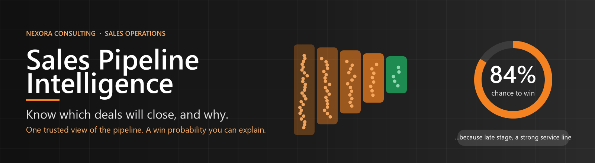
</p>

> *A worked example of the sales-operations analytics I build for revenue leaders. Fictional company, synthetic data, real-world problems.*

## Tech stack

| Layer | Tools and skills |
|---|---|
| **Transformation** |       |
| **Data quality** |       |
| **Machine learning** |          |
| **BI & analytics** |       |
| **DevOps** |      |
| **Domain** |     |

---

## At a glance

| €179M | 43% | 54% → 8% | 27 of 27 |
|:---:|:---:|:---:|:---:|
| open pipeline, in one trusted view | of it at risk (stuck, stale, overdue) | forecast error, CRM stage odds vs our model | automated quality checks pass |

---

## 1. The problem

- Sales data lives in a CRM nobody fully trusts
- Two system versions, 29 spellings of the same stage, duplicate clients, 8 currencies
- Reps type their own win probabilities, so the forecast depends on who is optimistic
- Nobody can say which deals are stuck, or **why** one deal is likelier to close than another
- The Monday pipeline meeting argues about whose numbers are right

**The cost:** forecast surprises, rescue calls made too late, and deals counted that will never close.

---

## 2. What is a win probability?

<p align="center">
  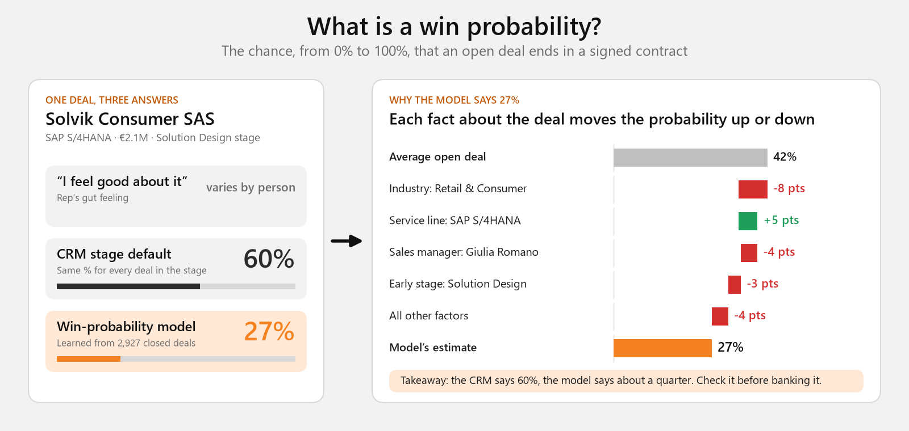
</p>

- **The chance, 0–100%, that an open deal ends in a signed contract**
- Reps guess it. The CRM uses one fixed number per stage. **Our model learns it from history.**
- Every deal gets its own number **and its reasons**: which facts push it up, which pull it down
- It is **advisory**: shown beside the governed forecast, never replacing it

### One deal, read in 20 seconds
**Solvik Consumer SAS** · SAP S/4HANA · €2.1M · Solution Design

> **CRM says 60%. Model says 27%.** *(an average open deal: 42%)*

| | Why, in a few words | Effect |
|:---:|---|---:|
| 🔻 | Retail & Consumer Goods clients convert below average | **−8** |
| 🔺 | SAP S/4HANA converts above average | **+5** |
| 🔻 | The sales manager's deals convert below average | **−4** |
| 🔻 | Solution Design: early, many deals still drop out | **−3** |
| 🔻 | Deal size (€2.1M) works against it | **−2** |

- **Read it like this:** start at 42% for an average open deal, apply the facts above (plus a few small ones), land at 27%
- **Effects are percentage points**, compared with an average open deal
- **Action:** don't bank this deal at 60%. Check the buying committee first
- **Patterns, not causes:** "below average" describes how similar deals behaved in the past

---

## 3. What was built

<p align="center">
  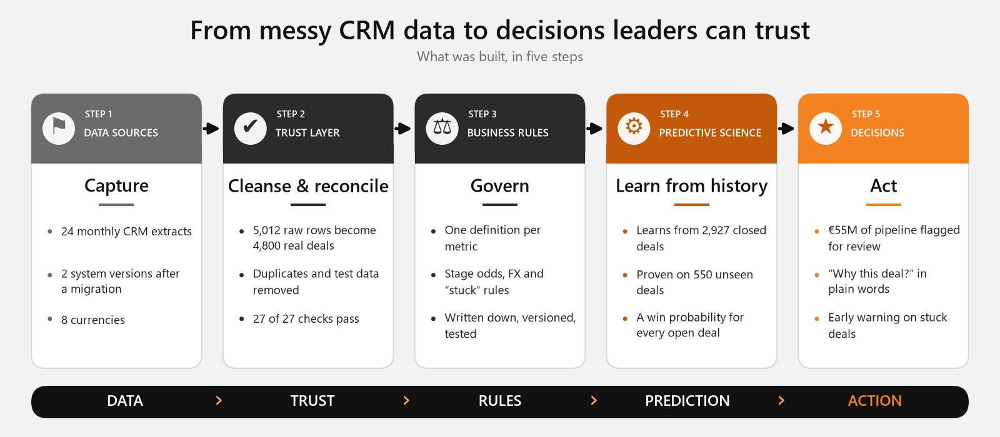
</p>

- **Trust layer:** 5,012 raw rows → 4,800 real deals, reconciled to the CRM's own totals
- **Business rules:** one written definition for every metric
- **Predictive science:** tested on 550 deals the model had never seen
- **Decisions:** seven dashboard pages, built around the questions a CRO asks every week

---

## 4. The questions it answers

| # | The CRO asks | Page |
|---|---|---|
| 1 | Will we hit the number? Is the pipeline healthy? | Pipeline Health & Forecast |
| 2 | Where are deals stuck? How much money is at risk? | Deal Velocity & Stuck Deals |
| 3 | Who turns pipeline into revenue? | Manager & Department Performance |
| 4 | Where in Europe should we invest next? | Europe Market Opportunity |
| 5 | Which deals will really close? Can we trust the forecast? | Win Probability |
| 6 | **Why does the model think this deal will (not) convert?** | **Why this deal?** |
| 7 | Can I trust these numbers? | Data Trust |

### Page 1 · Will we hit the number?
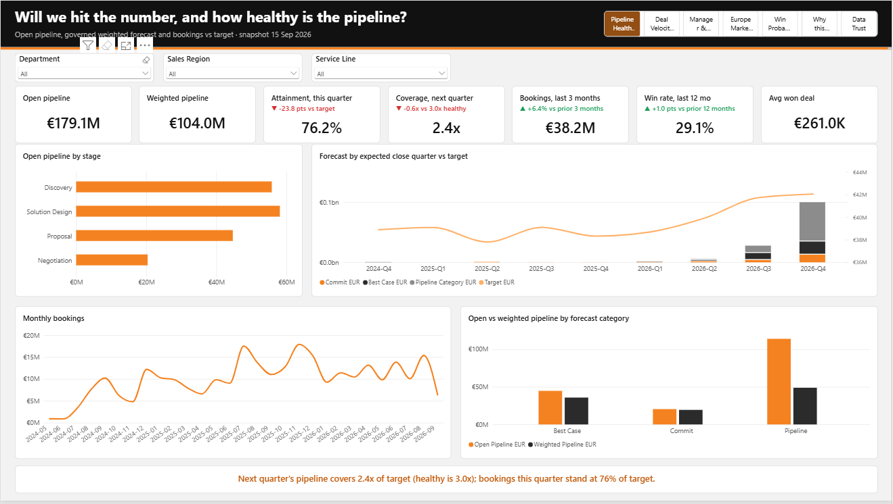
- **€179.1M** open pipeline, **€104.0M** after stage weighting (724 open deals)
- Next quarter is covered **2.4×**, below the 3× we consider healthy: act before the quarter starts

### Page 2 · Where are deals stuck?
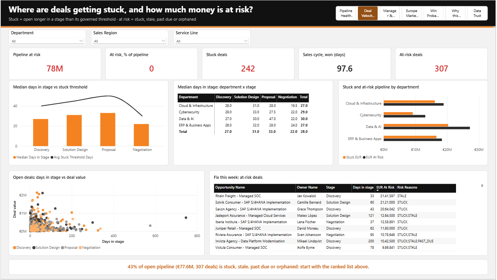
- **242 deals stuck** (€62M, 35% of pipeline); **€77.6M (43%) at risk** in total
- Data & AI deals sit **47 days in Proposal vs 28** elsewhere
- A ranked "fix this week" list, with a reason per deal

### Page 3 · Who converts?
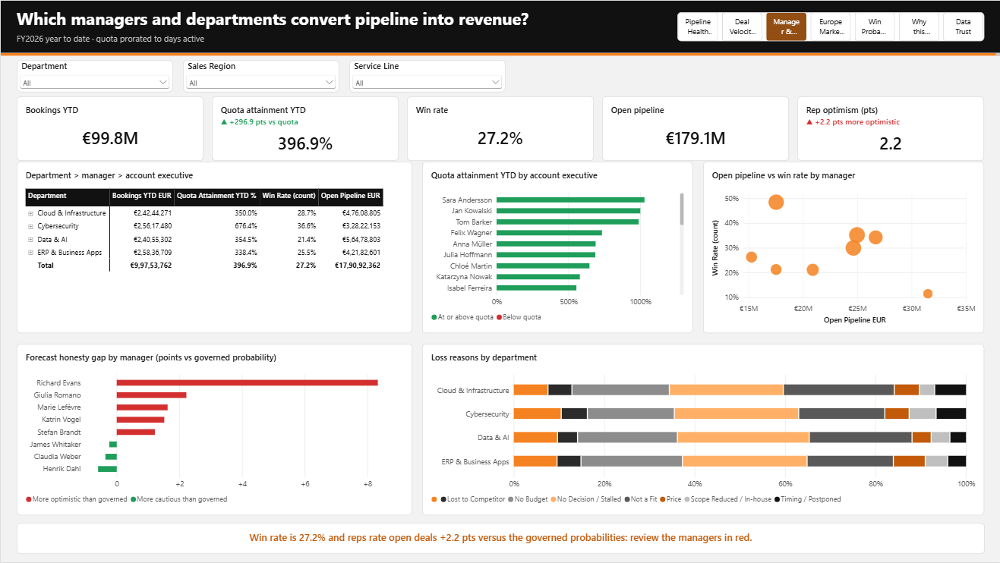
- Cybersecurity wins **36.6%** of decided deals, Data & AI **21.4%**
- Quota attainment per rep, prorated to days active
- Forecast optimism by manager

### Page 4 · Where to invest?
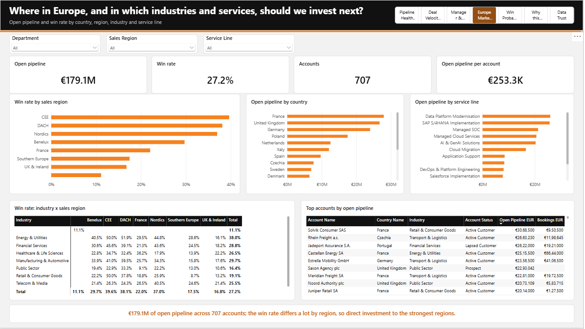
- **CEE, DACH, Nordics win 37–40%**; UK & Ireland and Southern Europe win **17–18%**
- **Energy & Utilities** converts best: 38% vs 27% overall
- 765 duplicate client records merged into 720

### Page 5 · Can we trust the forecast?
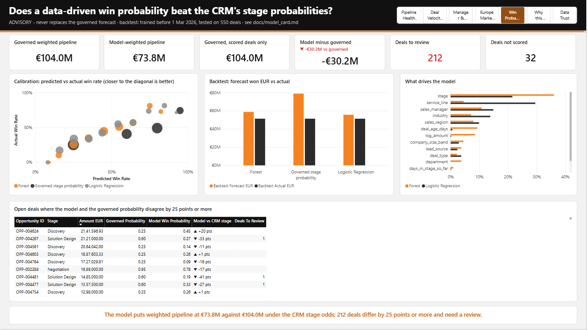
- CRM stage odds **over-forecast won revenue by 54%**; the model by **8%**
- Better at ranking winners above losers (AUC 0.725 vs 0.665)
- **212 deals** where model and CRM differ by 25+ points; on 207 of them the model is more cautious (**€54.9M**)

### Page 6 · Why this deal?
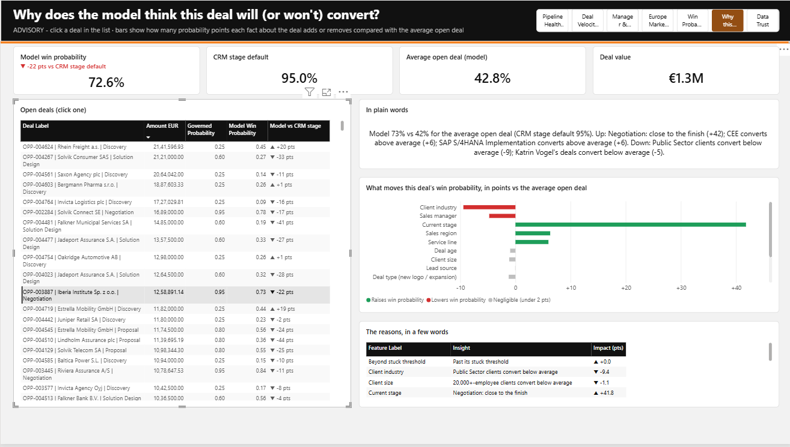
- Click any open deal: its probability, the CRM's number, and **the reasons in points**
- Example: *Solvik Consumer SAS*, €2.1M. CRM says 60%, model says **27%**: industry −8, sales-manager track record −4, early stage −3, service line +5
- Use it to **challenge or confirm** a forecast, deal by deal

### Page 7 · Can I trust these numbers?
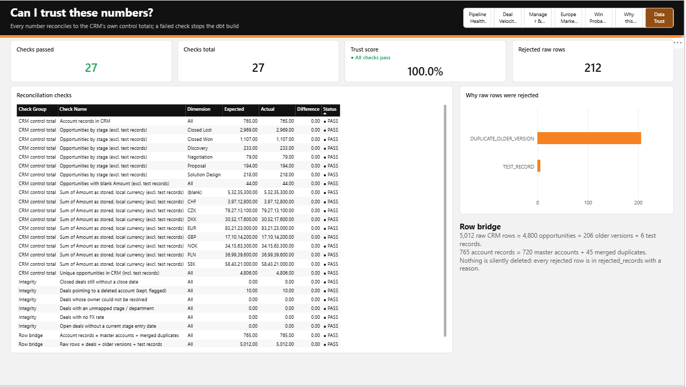
- **27 of 27 checks pass**, reconciled to the CRM's own control totals
- Every rejected row is listed with its reason: nothing silently deleted

---

## 5. What a business gets

- **One version of the truth:** every metric defined once, in writing
- **A forecast you can defend:** error cut from 54% to 8% in the backtest
- **Early warning, not hindsight:** stuck and at-risk deals ranked by money
- **Better pipeline conversations:** reasons per deal replace "I feel good about this one"
- **Confidence in the data:** a failed check stops the build before it reaches a dashboard

> **Honest note:** a driver such as "sales manager" is a prompt to investigate (qualification? territory mix?), not a verdict on a person.

---
---

# Under the hood *(for the technical reader)*

## 6. Technical architecture

<p align="center">
  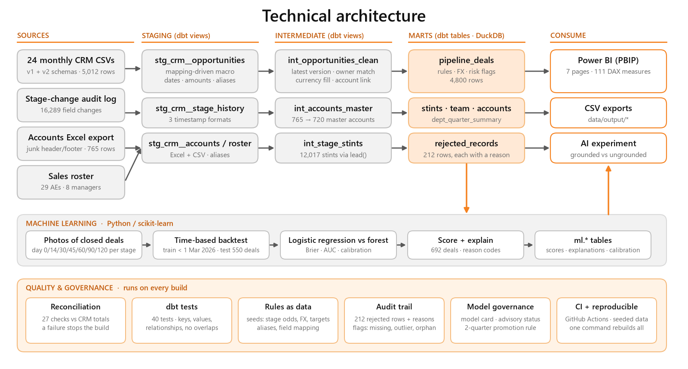
</p>

- **Stack:** dbt Core + DuckDB, Python (scikit-learn), Power BI (PBIP), GitHub Actions
- **Rules as data:** stage odds, FX, targets, aliases and the CRM field mapping are dbt seeds
- **Schema drift:** one macro builds a `COALESCE` per field from the mapping table across both CRM versions
- **Lineage:** `dbt docs serve --profiles-dir .`

## 7. Data quality: what was fixed

| Problem found | Fix | Result |
|---|---|---|
| Same deal exported repeatedly | Keep latest version, log the rest | 206 older versions rejected |
| CRM test records | Rule-based detection | 6 removed, listed |
| 29 stage spellings, 59 country spellings | Governed alias table + uniqueness test | 0 unmapped values |
| Duplicate clients | Normalised company key, lowest ID is master | 765 → 720 |
| Owners typed as names or initials | 4-pass matching | 4,800 of 4,800 resolved |
| Blank currency | Amount text, then account country | 138 filled |
| Amounts: 5 formats, 44 blank, 4 negative, 3 outliers | Parsed, flagged, outliers excluded from € metrics | All flagged, none dropped |
| Deals pointing to deleted accounts | Kept and flagged | 10 |
| No "days in stage" in the CRM | Rebuilt from the audit log | 12,017 stints |

## 8. Governance: steps taken so far

- **Business definitions:** every metric, rule and reason in [`docs/business_definitions.md`](docs/business_definitions.md), with a change log
- **Reconciliation gate:** 27 checks against CRM control totals; **any failure fails the build**
- **40 dbt tests:** keys, accepted values, relationships, no overlapping stints
- **Audit trail:** `rejected_records` with a reason per row; `dq_flags` per deal
- **Model card:** features used, features excluded (and why), validation design, limitations: [`docs/model_card.md`](docs/model_card.md)
- **Model status "Advisory":** promoted only after two quarters of beating the governed forecast, with sign-off
- **Reproducible:** seeded synthetic data, one command rebuilds everything, CI on every push

## 9. The model: inputs, training and validation

### In plain words
- The model reads a deal the way an experienced sales manager would: where it is, what kind of deal, which service and client, who runs it, how long it has been going
- It has seen 2,927 closed deals and learned which combinations ended in a signature
- For every open deal it returns a **chance to win and the reasons**. It is advisory and never replaces the governed forecast

### Data behind it
| Source | Size | What it gives the model |
|---|---|---|
| CRM opportunity extracts | 24 monthly CSVs, 5,012 raw rows, 18 fields each (36 column names across two schema versions) | Stage, amount, currency, service line, lead source, dates, owner, outcome |
| Stage-change audit log | 16,289 changes | Days in stage, moves backwards, the state of a deal on any past day |
| Accounts Excel export | 765 records, merged into 720 | Industry, client size, country and region |
| Sales roster | 29 account executives, 8 managers | Sales manager and department |
| Reference tables | 7 | Stage rules, FX rates, country mapping and aliases: used to clean and convert, not as inputs |

After cleaning, `pipeline_deals` has 4,800 deals and 60 columns (about 30 derived) and `pipeline_stage_stints` has 12,017 rows. The Power BI model adds 111 measures.

### What goes in: 13 features (6 of them derived)
| Group | Features | Derived by us? |
|---|---|---|
| Deal | stage, service line, deal type (new logo / expansion), deal size (log of the euro amount) | deal type, deal size |
| Client | industry, client size, sales region | |
| Sales | sales manager, lead source | |
| Timing | days in current stage, deal age, times moved backwards, over the stuck threshold | all four |

The random forest also sees the department. The rep's own probability, forecast category, expected close date, loss reason, activity dates and account status are excluded on purpose: they reveal the answer or only exist after a deal closes.

### How it is trained
1. **Photos.** For each closed deal, take a snapshot on day 0, 14, 30, 45, 60, 90 and 120 of every open stage it sat in. Each photo holds only what was known that day, plus the final result (won or lost): 20,574 photos from 2,927 deals
2. **Split by time.** Train on deals closed before 1 Mar 2026, test on the 550 deals still open that day. All photos of a deal stay on the same side
3. **Compare.** CRM stage odds against logistic regression and a random forest, on Brier score, AUC and forecast error in euros
4. **Choose.** Logistic regression: the lowest Brier score, and every coefficient can be explained
5. **Retrain and score.** Refit on all 4,061 deals closed before 15 Sep 2026 (29,348 photos) and score 692 of the 724 open deals (32 have no amount)
6. **Explain.** For each deal, each fact's push on the probability in points, against an average open deal (42%)

**Biggest drivers:** service line 30%, stage 22%, sales manager 15%, industry 14%, sales region 10%. A driver describes how similar deals behaved, not why, so a manager or industry effect is a prompt to investigate, not a verdict.

### Validation
- **Leakage-safe:** only facts known while the deal is open
- **Time-based backtest:** trained on deals closed before 1 Mar 2026, tested on the 550 deals open that day

| Method | Brier ↓ | AUC ↑ | Won-revenue forecast error |
|---|---|---|---|
| CRM stage probabilities | 0.264 | 0.665 | +54% |
| **Logistic regression (chosen)** | **0.208** | **0.725** | **+8%** |
| Random forest | 0.210 | 0.717 | +15% |

- **Explainable:** reason codes per deal in `ml.model_explanations`, shown on the "Why this deal?" page
- **Limits:** synthetic data with designed patterns, 550 test deals, one backtest date and no confidence intervals. Treat the gaps as indicative. Full detail in [`docs/model_card.md`](docs/model_card.md)

## 10. Repository map
```
├── models/          dbt: staging → intermediate → marts, with tests
├── macros/          schema-drift macro, parsers, alias lookup
├── tests/           reconciliation must pass, no overlapping stints, …
├── data/            raw (synthetic) · reference (dbt seeds) · output (CSV exports)
├── ml/              win-probability model + per-deal explanations
├── powerbi/         Power BI project (.pbip), DAX measures, theme
├── images/          README and dashboard images
├── docs/            plan, business definitions, model card, checklist
├── scripts/         pipeline runner, exports, image + Power BI generators
├── ai_experiment/   grounded vs ungrounded AI protocol
└── archive/         first iteration, built in Alteryx
```

## 11. Run it
```bash
pip install -r requirements.txt
python scripts/run_pipeline.py     # dbt build → model → CSV exports → docs
```
Then open `powerbi/PowerBI_Workbook.pbip` and refresh. See [`powerbi/README.md`](powerbi/README.md).

## 12. About
Built by **Priyanshi Jani** as a worked example of sales-operations analytics: a trusted data layer, a forecast you can defend and dashboards a CRO can act on.
GitHub: [priyanshijani](https://github.com/priyanshijani) · [Tech stack](#tech-stack)

*All companies, people and figures are fictional and were generated for learning purposes.*
