<p align="center">
  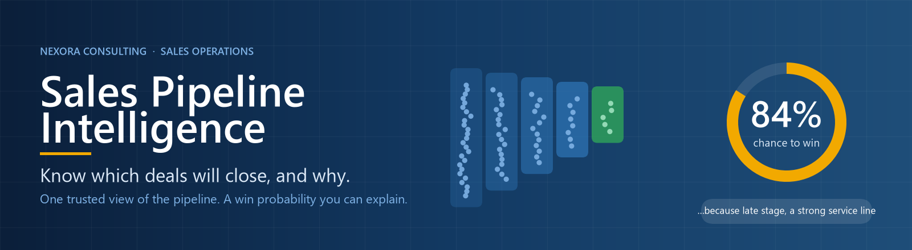
</p>

<p align="center">
  
  
  
  
</p>

> *A worked example of the sales-operations analytics I build for revenue leaders. Fictional company, synthetic data, real-world problems.*

---

## At a glance

| €179M | 43% | 54% → 8% | 27 of 27 |
|:---:|:---:|:---:|:---:|
| open pipeline, in one trusted view | of it at risk (stuck, stale, overdue) | forecast error, CRM stage odds vs our model | automated quality checks pass |

---

## 1. The problem

- Sales data lives in a CRM nobody fully trusts
- Two system versions, 29 spellings of the same stage, duplicate clients, 8 currencies
- Reps type their own win probabilities, so the forecast depends on who is optimistic
- Nobody can say which deals are stuck, or **why** one deal is likelier to close than another
- The Monday pipeline meeting argues about whose numbers are right

**The cost:** forecast surprises, rescue calls made too late, and deals counted that will never close.

---

## 2. What is a win probability?

<p align="center">
  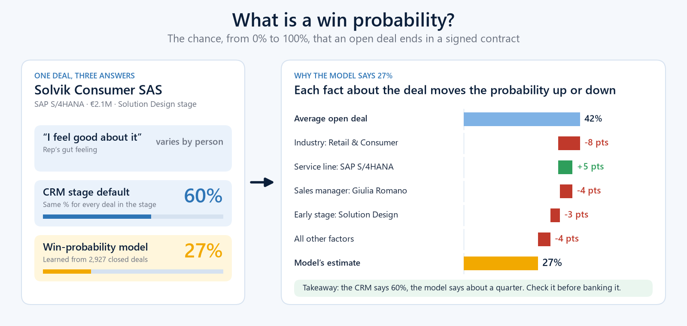
</p>

- **The chance, 0–100%, that an open deal ends in a signed contract**
- Reps guess it. The CRM uses one fixed number per stage. **Our model learns it from history.**
- Every deal gets its own number **and its reasons**: which facts push it up, which pull it down
- It is **advisory**: shown beside the governed forecast, never replacing it

### One deal, read in 20 seconds
**Solvik Consumer SAS** · SAP S/4HANA · €2.1M · Solution Design

> **CRM says 60%. Model says 27%.** *(an average open deal: 42%)*

| | Why, in a few words | Effect |
|:---:|---|---:|
| 🔻 | Retail & Consumer Goods clients convert below average | **−8** |
| 🔺 | SAP S/4HANA converts above average | **+5** |
| 🔻 | The sales manager's deals convert below average | **−4** |
| 🔻 | Solution Design: early, many deals still drop out | **−3** |
| 🔻 | Deal size (€2.1M) works against it | **−2** |

- **Read it like this:** start at 42% for an average open deal, apply the facts above (plus a few small ones), land at 27%
- **Effects are percentage points**, compared with an average open deal
- **Action:** don't bank this deal at 60%. Check the buying committee first
- **Patterns, not causes:** "below average" describes how similar deals behaved in the past

---

## 3. What was built

<p align="center">
  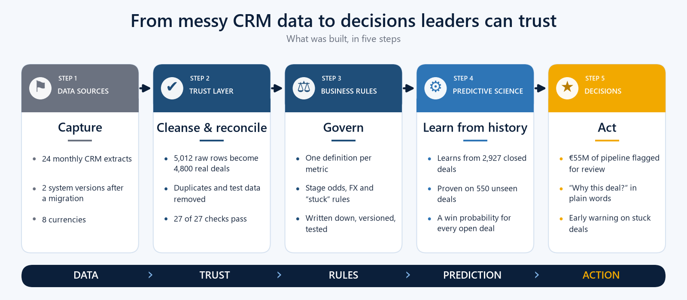
</p>

- **Trust layer:** 5,012 raw rows → 4,800 real deals, reconciled to the CRM's own totals
- **Business rules:** one written definition for every metric
- **Predictive science:** tested on 550 deals the model had never seen
- **Decisions:** seven dashboard pages, built around the questions a CRO asks every week

---

## 4. The questions it answers

| # | The CRO asks | Page |
|---|---|---|
| 1 | Will we hit the number? Is the pipeline healthy? | Pipeline Health & Forecast |
| 2 | Where are deals stuck? How much money is at risk? | Deal Velocity & Stuck Deals |
| 3 | Who turns pipeline into revenue? | Manager & Department Performance |
| 4 | Where in Europe should we invest next? | Europe Market Opportunity |
| 5 | Which deals will really close? Can we trust the forecast? | Win Probability |
| 6 | **Why does the model think this deal will (not) convert?** | **Why this deal?** |
| 7 | Can I trust these numbers? | Data Trust |

### Page 1 · Will we hit the number?
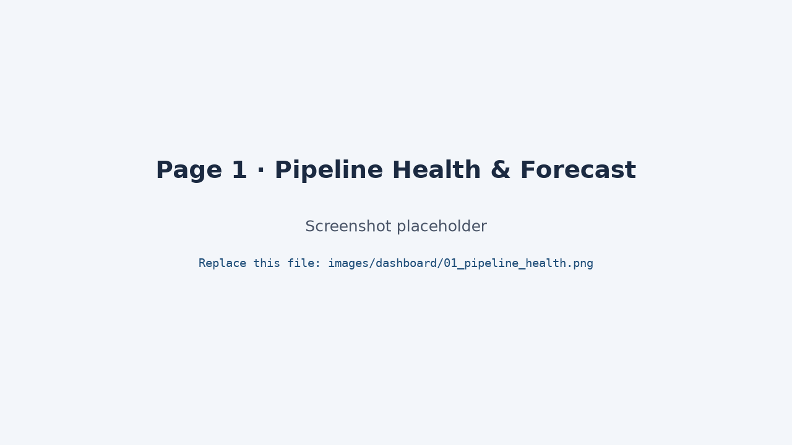
- **€179.1M** open pipeline, **€104.0M** after stage weighting (724 open deals)
- Next quarter is covered **2.4×**, below the 3× we consider healthy: act before the quarter starts

### Page 2 · Where are deals stuck?
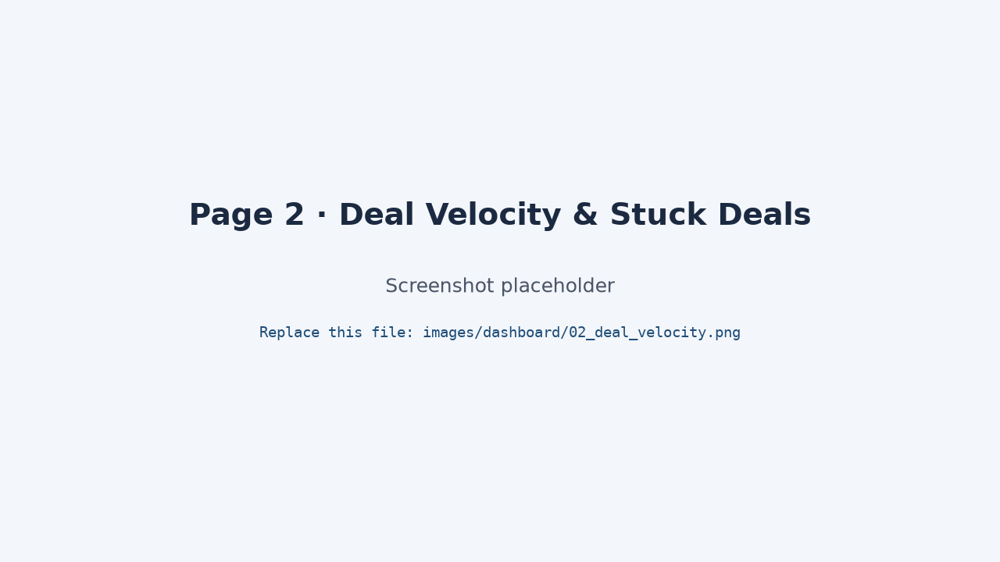
- **242 deals stuck** (€62M, 35% of pipeline); **€77.6M (43%) at risk** in total
- Data & AI deals sit **47 days in Proposal vs 28** elsewhere
- A ranked "fix this week" list, with a reason per deal

### Page 3 · Who converts?
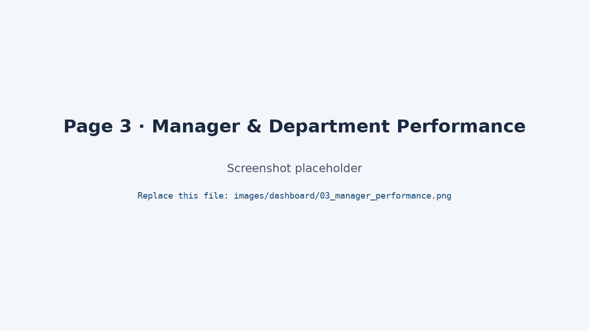
- Cybersecurity wins **36.6%** of decided deals, Data & AI **21.4%**
- Quota attainment per rep, prorated to days active
- Forecast optimism by manager

### Page 4 · Where to invest?
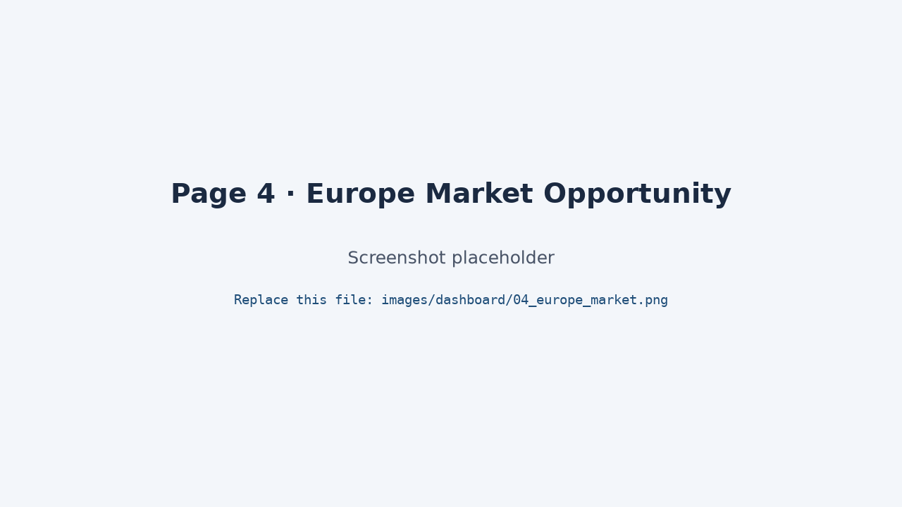
- **CEE, DACH, Nordics win 37–40%**; UK & Ireland and Southern Europe win **17–18%**
- **Energy & Utilities** converts best: 38% vs 27% overall
- 765 duplicate client records merged into 720

### Page 5 · Can we trust the forecast?
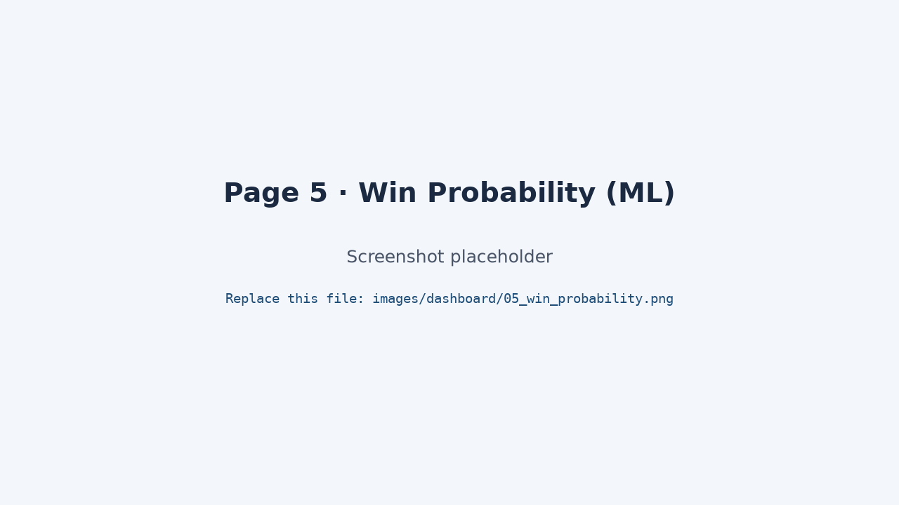
- CRM stage odds **over-forecast won revenue by 54%**; the model by **8%**
- Better at ranking winners above losers (AUC 0.725 vs 0.665)
- **212 deals** where model and CRM differ by 25+ points; on 207 of them the model is more cautious (**€54.9M**)

### Page 6 · Why this deal?
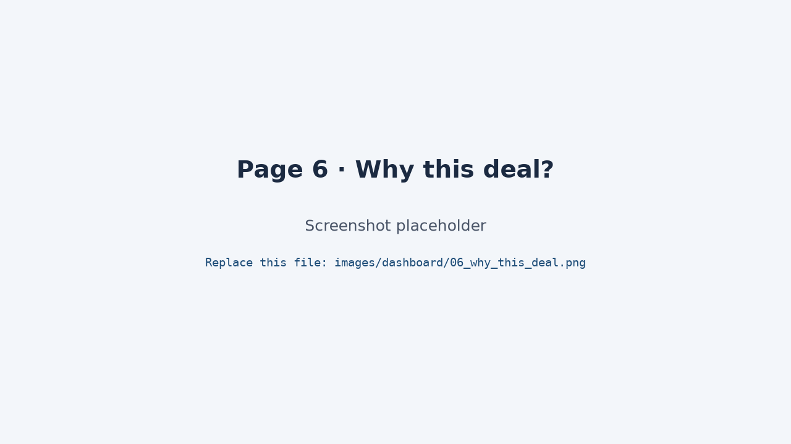
- Click any open deal: its probability, the CRM's number, and **the reasons in points**
- Example: *Solvik Consumer SAS*, €2.1M. CRM says 60%, model says **27%**: industry −8, sales-manager track record −4, early stage −3, service line +5
- Use it to **challenge or confirm** a forecast, deal by deal

### Page 7 · Can I trust these numbers?
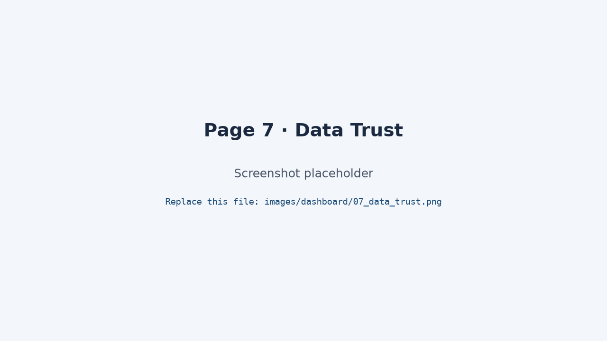
- **27 of 27 checks pass**, reconciled to the CRM's own control totals
- Every rejected row is listed with its reason: nothing silently deleted

---

## 5. What a business gets

- **One version of the truth:** every metric defined once, in writing
- **A forecast you can defend:** error cut from 54% to 8% in the backtest
- **Early warning, not hindsight:** stuck and at-risk deals ranked by money
- **Better pipeline conversations:** reasons per deal replace "I feel good about this one"
- **Confidence in the data:** a failed check stops the build before it reaches a dashboard

> **Honest note:** a driver such as "sales manager" is a prompt to investigate (qualification? territory mix?), not a verdict on a person.

---
---

# Under the hood *(for the technical reader)*

## 6. Technical architecture

<p align="center">
  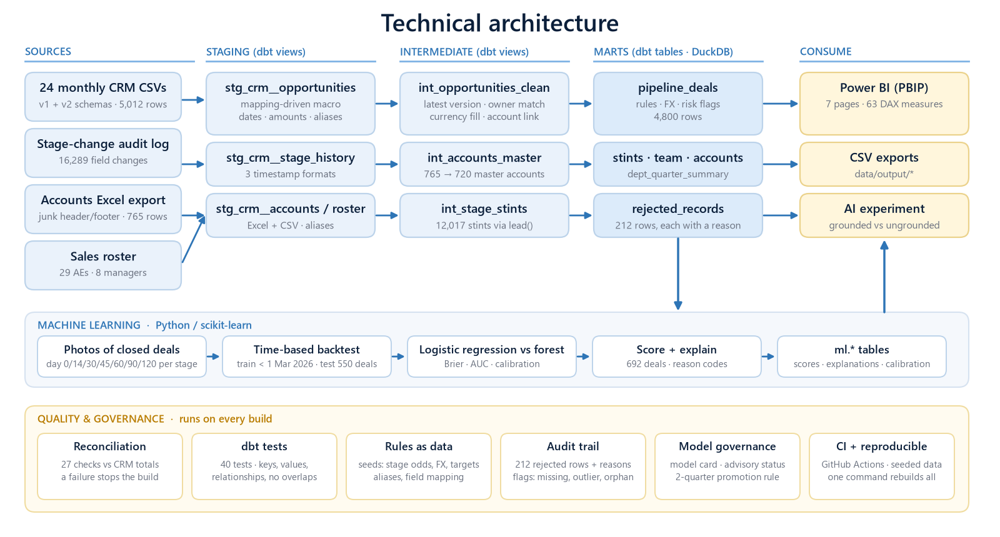
</p>

- **Stack:** dbt Core + DuckDB, Python (scikit-learn), Power BI (PBIP), GitHub Actions
- **Rules as data:** stage odds, FX, targets, aliases and the CRM field mapping are dbt seeds
- **Schema drift:** one macro builds a `COALESCE` per field from the mapping table across both CRM versions
- **Lineage:** `dbt docs serve --profiles-dir .`

## 7. Data quality: what was fixed

| Problem found | Fix | Result |
|---|---|---|
| Same deal exported repeatedly | Keep latest version, log the rest | 206 older versions rejected |
| CRM test records | Rule-based detection | 6 removed, listed |
| 29 stage spellings, 59 country spellings | Governed alias table + uniqueness test | 0 unmapped values |
| Duplicate clients | Normalised company key, lowest ID is master | 765 → 720 |
| Owners typed as names or initials | 4-pass matching | 4,800 of 4,800 resolved |
| Blank currency | Amount text, then account country | 138 filled |
| Amounts: 5 formats, 44 blank, 4 negative, 3 outliers | Parsed, flagged, outliers excluded from € metrics | All flagged, none dropped |
| Deals pointing to deleted accounts | Kept and flagged | 10 |
| No "days in stage" in the CRM | Rebuilt from the audit log | 12,017 stints |

## 8. Governance: steps taken so far

- **Business definitions:** every metric, rule and reason in [`docs/business_definitions.md`](docs/business_definitions.md), with a change log
- **Reconciliation gate:** 27 checks against CRM control totals; **any failure fails the build**
- **40 dbt tests:** keys, accepted values, relationships, no overlapping stints
- **Audit trail:** `rejected_records` with a reason per row; `dq_flags` per deal
- **Model card:** features used, features excluded (and why), validation design, limitations: [`docs/model_card.md`](docs/model_card.md)
- **Model status "Advisory":** promoted only after two quarters of beating the governed forecast, with sign-off
- **Reproducible:** seeded synthetic data, one command rebuilds everything, CI on every push

## 9. The model, validated

- **Leakage-safe:** only facts known while the deal is open; the rep's own probability, close date, loss reason and activity dates are excluded
- **Time-based backtest:** trained on deals closed before 1 Mar 2026, tested on the 550 deals open that day

| Method | Brier ↓ | AUC ↑ | Won-revenue forecast error |
|---|---|---|---|
| CRM stage probabilities | 0.264 | 0.665 | +54% |
| **Logistic regression (chosen)** | **0.208** | **0.725** | **+8%** |
| Random forest | 0.210 | 0.717 | +15% |

- **Explainable:** reason codes per deal in `ml.model_explanations`

## 10. Repository map
```
├── models/          dbt: staging → intermediate → marts, with tests
├── macros/          schema-drift macro, parsers, alias lookup
├── tests/           reconciliation must pass, no overlapping stints, …
├── data/            raw (synthetic) · reference (dbt seeds) · output (CSV exports)
├── ml/              win-probability model + per-deal explanations
├── powerbi/         Power BI project (.pbip), DAX measures, theme
├── images/          README and dashboard images
├── docs/            plan, business definitions, model card, checklist
├── scripts/         pipeline runner, exports, image + Power BI generators
├── ai_experiment/   grounded vs ungrounded AI protocol
└── archive/         first iteration, built in Alteryx
```

## 11. Run it
```bash
pip install -r requirements.txt
python scripts/run_pipeline.py     # dbt build → model → CSV exports → docs
```
Then open `powerbi/PowerBI_Workbook.pbip` and refresh. See [`powerbi/README.md`](powerbi/README.md).

## 12. Skills shown
**Business:** metric definition, forecasting, sales operations, stakeholder storytelling ·
**BI:** Power BI, DAX, star schema ·
**ML:** leakage-safe features, backtesting, calibration, explainability ·
**Data engineering:** dbt, SQL window functions, entity resolution, schema drift ·
**Quality:** reconciliation, tests, audit trail ·
**Practice:** CI, version control, reproducibility

## 13. About
<!-- TODO: your name, one line about you, LinkedIn link -->
*All companies, people and figures are fictional and were generated for learning purposes.*
